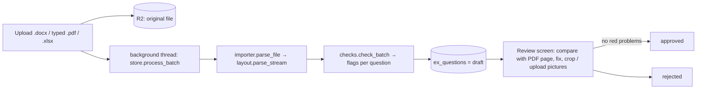

# Mock Tests (NEET PG) — exam engine

Founder-approved brief: `~/Desktop/Claude Code/NEET_PG_Mock_Platform_Brief.md`.

**Decisions (founder, 13 Nov 2026)**
- Practice mocks, taken anytime from a purchased package; one free full sample mock. Fixed-date all-India mocks may come later.
- Packages (prices include GST, valid until NEET PG 2027):
  - Starter: 5 full mocks, ₹999
  - Standard: 15 full mocks + 19 subject tests, ₹2,499
  - Pro: 30 full mocks + subject tests + mini tests, ₹3,999
- The free mock is a full 180-question mock with full results: score, rank, subject-wise analysis, solutions, predicted rank and college list.
- **Runs inside the portal** (no new Render cost). The exam screen will be on goocampus.in (Next.js). The engine is kept self-contained:
  - its own `exam_engine/` folder;
  - its own `ex_*` tables;
  - `tenant_id` on every row;
  - no joins into portal tables.

  So it can move to its own service and database if load ever needs it.

## Build order (from the brief)
1. Competitor research and packages: **done**.
2. Decisions: **done**. Launch date still to come.
3. Question importer: **done**, on staging.
4. Question bank and paper builder: **done** (see below).
5. Exam engine: **portal side done**. The goocampus.in exam screen is built by the website session from [mock-tests-api.md](mock-tests-api.md).
6. Scoring, results and rank: **done** (see below).
7. Packages, payments and the free sample: **done** (see below).
8. Admin dashboard.
9. Load test and dry run.

## Step 3 — question import (`/admin/pg/mocks/import`, admin only)

**Readers.** Each reader turns its file into one stream of lines and images, which `layout.py` reads.
- `docx_reader.py`:
  - reads paragraphs and table cells in document order;
  - picks up pasted pictures in place;
  - rebuilds Word's automatic numbering, so "A." / "1." labels added by a list are not lost.
- `pdf_reader.py` (pypdfium2, typed PDFs only):
  - reads line text and position;
  - drops running headers and footers (repeated at a page edge on 3+ pages and never mid-page);
  - cuts embedded pictures from the rendered page.
  - Diagrams drawn as lines are not "pictures" inside a PDF; the team crops those on the review screen.
  - A scanned PDF is refused with a plain message.
- `xlsx_reader.py`: one row per question; headers are matched loosely; text only.

**Layout recognised**
- `Q12.` or `Q12  SURGERY / RADIOLOGY` (subject tags) or `12.`
- An optional `IMAGE FINDING` box.
- Options `A.`–`D.`, or `1.`–`4.` (a ✓ / (correct) / leading `*` marks the key).
- `Answer: C`, or `ANSWER` followed by `C. …` on the next line.
- `Explanation:`, or the boxes HOW TO SOLVE / DEEP-DIVE / PATTERN / KEY FACT.
- `Subject:` and `Topic:`.
- A picture before the answer belongs to the question; a picture after it belongs to the explanation.

**Check report** (`importer/checks.py`). Red problems block approval:
- no question text;
- not exactly 4 options, or an empty option;
- no answer;
- the ✓ and the Answer line disagree;
- the question is built on an image but has none;
- subject not recognised;
- repeated in the file, or already in the bank;
- a picture format browsers can't show (EMF/WMF).

Warnings:
- the question mentions an image but has none;
- subject taken from the second tag;
- no explanation;
- doubled words;
- two options with the same text.

File-level notes: missing or repeated question numbers, how the correct answers are spread across A–D, and skipped index entries.

**Subjects.** NEET PG's 19 subjects live in `ex_subjects`. Specialities are mapped to subjects in `ex_subject_aliases` (Cardiology → Medicine, Urology → Surgery, etc.).
- Oncology, Genetics and Hematology are deliberately left for the team to decide.
- A choice made on the review screen is remembered for every later file and applied to the rest of the current file.

**Rules**
- A PDF question needs the "I checked it against the PDF page" tick before it can be approved.
- Word and Excel imports can bulk-approve their questions that have no problems.
- Editing an approved question saves the old version in `ex_question_versions` and sends it back for approval.
- An import can be read again or discarded only while nothing in it is approved or rejected.

**Storage**
- Originals: `exam_engine/t<tenant>/imports/<batch>/…`
- Pictures: `exam_engine/t<tenant>/q/<qid>/.<ext>`
- Page renders: cached under `…/imports/<batch>/pages/<n>.png`

Without R2, the bytes are stored in the row.

**Not done yet:** the AI route for PDFs in other layouts or scanned PDFs (the brief's "AI splits the PDF"). It will be added once a real file needs it. Typed PDFs in a labelled layout don't need AI.

## Step 4 — question bank and papers

**Screens**
- `/admin/pg/mocks/bank`:
  - search and filter: subject, topic, status, used or unused, has a picture;
  - "Type a question" creates a blank draft and opens it in the review screen.
- `/admin/pg/mocks/papers`: create a paper:
  - **Full mock**: the pattern's 5 × 36 questions, 42 minutes per section.
  - **Subject test**: 60 questions, 70 minutes, one subject.
  - **Mini test**: 30 questions, 35 minutes.
  - The subject-test and mini-test sizes are editable defaults.
- `/admin/pg/mocks/papers/<id>` is the builder:
  - Sections with numbered slots; move a question up, down or to another section; remove it.
  - Picker: search approved questions and add the ticked ones to a section.
  - **Auto-fill** follows the subject mix (or the test's own subject). It prefers questions not used in any other paper, can top up from other subjects when one runs short, and spreads subjects round-robin across the sections.
  - The "Ready to lock?" panel shows what blocks locking and what's worth a look. It blocks on:
    - a section not full;
    - a question no longer approved;
    - the same question twice.

    It warns about:
    - a subject mix off by 3 or more;
    - answer-letter skew;
    - questions reused from other locked or published papers.
- `/admin/pg/mocks/papers/<id>/preview`: the whole paper as doctors will see it, with or without answers, printable.
- `/admin/pg/mocks/pattern`: the exam pattern as settings:
  - sections, minutes, marking, options;
  - section rules (no going back, each section runs its full time);
  - subject-test and mini-test sizes;
  - the subject mix for auto-fill.

  Saving creates a new version. Each paper copies the pattern when it is created, so later changes never alter an existing paper.

**Paper lifecycle** (`ex_papers.status`): draft → locked → published → retired.
- **Lock**: every question is frozen into `ex_paper_items.snapshot_json` (text, options, answer, explanation, subject, picture ids, question version). Later bank edits don't change the paper; the builder marks such questions "edited in bank since".
- A picture inside a frozen copy can't be deleted from its question.
- **Unlock**: only while locked, never once published, and never after doctors have attempted it (`attempts_count`, which reads `ex_attempts` once Step 5 adds it).
- Only a draft paper can be deleted.
- Exactly one full mock can be the **free sample** (`is_free_sample`).

**Default subject mix**: `tables.BLUEPRINT_PER_200`, scaled to 180. It is an approximation of recent papers, for the team to adjust on the Pattern page.

## Step 5 — exam engine (portal side)

- `exam_engine/attempts.py` holds the server clock, autosave, section changes, submission and scoring.
- `exam_engine/doctor_api.py` holds the `/api/pg/mocks/*` endpoints. They use the same X-PG-Key + Bearer token as every other goocampus.in call.
- `exam_engine/access.py` decides who may take a paper:
  - the free sample: everyone;
  - team members: every published paper;
  - everyone else: a package (wired in step 7).

**Tables**

| Table | Holds |
|---|---|
| `ex_attempts` | One per doctor × paper attempt. The `sections_json` clock, `order_json` (question/option shuffle), the score. |
| `ex_attempt_answers` | One row per question per attempt: chosen original option key, marked, visited, time_ms, client_ts (newest wins), and is_correct + marks after submit. |
| `ex_attempt_events` | Malpractice flags and lifecycle events (started, resumed, section_closed, submitted). Flags only; nothing is ever disqualified. |

**Clock rules**
- Each section opens when the previous one closes, even if the doctor is away.
- A closed section is never reopened, and its questions are not sent again.
- NEET PG sections run their full time (`section_runs_full_time`). Subject and mini tests may finish early.
- Saves up to `GRACE_SECONDS = 20` after a close still count.
- When the paper ends, the next request submits it; otherwise the APScheduler `sweep()` does, every 2 minutes in every web process. This is idempotent: `UPDATE … WHERE status='in_progress'`.

**Scoring**
- +4 / −1 / 0 from the paper's own pattern.
- "Answered & marked" is scored; "marked" without an answer scores 0.
- Shuffling is stored per attempt; answers are always stored as the original option key.

**Other**
- `max_attempts` per paper defaults to 1 and can be edited on the paper's Details card.
- Shuffle settings (`shuffle_questions`, `shuffle_options`) are on the Exam pattern page; both are off by default.
- **Load:** a locked paper's questions are cached in memory, keyed by paper + `locked_at`. An autosave is about 3 small queries plus one UPDATE per changed answer.
- Pictures go out as presigned R2 links when R2 is used, otherwise as signed `/api/pg/mocks/img/<id>?t=…` links (itsdangerous, 6 h).

## Step 6 — results, rank, solutions, predicted NEET rank

- `exam_engine/results.py` builds the result page:
  - score, accuracy and marks lost to negatives;
  - rank, percentile, topper and average score;
  - section, subject and time analysis;
  - solutions with explanations and "% of doctors who got it right".
- `exam_engine/neet_curve.py` gives the predicted NEET PG All-India rank from the real NBEMS result (`pg_neet_result`, the latest year): AIR = 1 + candidates who scored more than this score on /720. The range is ±8 marks. Full mocks only, cached for 6 h. It is the engine's only read of a portal table.
- **Rank rules (founder 2026-11-13):**
  - Only a doctor's first submitted attempt is ranked (`ex_attempts.is_ranked`).
  - Retakes are practice; they show where the score would sit.
  - New mocks allow 3 attempts (`ex_papers.max_attempts`, editable per paper).
  - Team members (`pg_users.is_team_member`) are never ranked, even on the free sample.
- **Rank formula:** rank = 1 + ranked attempts with a higher score, so ties share a rank. Percentile = % of ranked attempts with a lower score.
- **"How everyone did"** (per question and per subject) is aggregated over ranked attempts and cached for 10 min per paper.
- APIs: `GET /api/pg/mocks/attempts/<id>/result` and `…/solutions[?section=]`, both only after submit. See [mock-tests-api.md](mock-tests-api.md) §7–8.
- **Future:** once doctors who took mocks also report their real NEET rank, calibrate each paper's difficulty (a marks offset) so the predicted rank tracks reality better.

## Step 7 — mock packages + payments

**Why the packages are separate.** Mock packages are **not** pg_plans or pg_subscriptions. The portal treats a doctor's newest active subscription as *the* plan, and granting a counselling plan (a PGCP invite or an admin grant) cancels the other active subscriptions. A mock package stored there would knock out, or be knocked out by, a counselling plan.

**Tables**

| Table | Holds |
|---|---|
| `ex_packages` | Starter ₹999 / 5 full mocks · Standard ₹2,499 / 15 + subject tests (recommended) · Pro ₹3,999 / 30 + subject + mini. Prices incl. GST. `valid_until` defaults to 2027-09-30 (to confirm with the founder). |
| `ex_orders` | Razorpay orders: list price, upgrade credit, coupon discount, payable, and the GST inside it (payable − payable/1.18). |
| `ex_package_purchases` | Grants: source `razorpay`, `coupon_free` or `admin_grant`, plus the access date. |

**How it works**
- `exam_engine/packages.py`: entitlement (the union of the doctor's live purchases), quote (upgrade = pay the difference; coupons via `pg_admin/data/coupons.py`, "all plans" coupons only) and grant.
- `exam_engine/access.py` checks, in order: team → free sample → full mock position ≤ the package's N → subject/mini flags.
- `exam_engine/store_api.py` holds `/api/pg/mocks/packages*`. It uses the portal's Razorpay keys (`_razorpay_creds`) and HMAC-verifies the signature. Verify is idempotent: an `UPDATE … WHERE status <> 'paid' RETURNING` claims the order once.
- Admin `/admin/pg/mocks/packages`: edit packages, see sales and revenue, give a package by mobile (with a reason), and turn a purchase off (e.g. after a refund).
