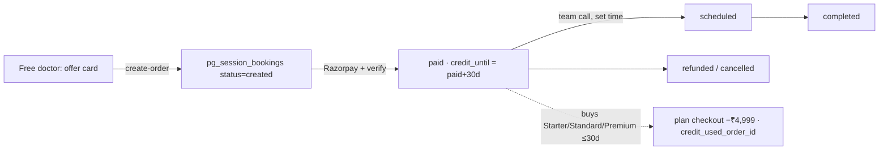

# Paid 1-on-1 Counselling Session (goocampus.in, free doctors)

Founder 2026-11-17. A one-time **₹4,999 incl. GST** product (₹4,236.44 + 18% GST ₹762.56) offered only to
**free** goocampus.in doctors (same test as the profile pop-up: `api.profile_gate_applies` — not team/desk,
not Starter/Standard/Premium incl. granted, no PGCP invitation).

At booking the doctor picks ONE:
- `session_1h` — a 1-hour counselling session (rules, authorities, quotas, college suggestions)
- `round_choice` — choice-entry **suggestions** for one round (we suggest, the doctor fills)

Terms: no seat guarantee · full refund if we can't schedule within 3 days · no refund once held ·
₹4,999 adjusted in full against ONE Starter/Standard/Premium checkout within 30 days.

Delivery: **Ashwini S** (default `assigned_to`). The team calls to fix a time (no slot picker yet).

## Code
- `pg_admin/routes/session_api.py` — everything (schema, doctor API, Desk API, admin tab, alert email).
- `pg_admin/routes/api.py` — `api_pg_checkout_create_order` applies the credit; `api_pg_checkout_verify` consumes it.
- Templates: `pg_admin/paid_sessions.html`, tab in `_users_tabs.html`, profile panel in `user_detail.html`.

## Tables (additive)
- `pg_session_bookings` — user_id, kind, round_note, amount_paise (499900), gst_inclusive, base_amount, gst_amount,
  gst_percent, razorpay_order_id/payment_id, status (created→paid→scheduled→completed | refunded | cancelled),
  paid_at, scheduled_at (UTC), completed_at, refunded_at, assigned_to, team_notes, credit_until,
  credit_used_order_id/at, alert_sent_at, created_by/updated_by, timestamps.
- `pg_session_booking_log` — field-level change log (who/when/source desk|portal|verify).
- `pg_orders.session_credit`, `pg_orders.session_booking_id`.

## Upgrade credit math
Plan checkout as before: taxable = price − coupon; gst = taxable × gst%; payable = taxable + gst.
If the plan code contains starter/standard/premium and the doctor has an unused credit (booking paid/scheduled/
completed, `credit_until` > now): credit = min(4999, payable − 1); payable −= credit; then GST is re-derived
from the reduced inclusive payable (gst = payable × g/(100+g)). Consumed only when that order verifies.
Example: plan ₹9,999 + 18% = ₹11,798.82 → credit ₹4,999 → payable ₹6,799.82 (taxable ₹5,762.56 + GST ₹1,037.26).

## Alerts
Booking alert email (admin + Ashwini) is OFF unless `PG_SESSION_ALERTS=1`. Recipients: the Counselling-Desk team
accounts' emails (Ashwini) PLUS any extra addresses in `PG_SESSION_ALERT_EMAILS` (comma list, e.g. the founder), de-duplicated.

## Access
Admin tab = admin or the Access Master grant goocampus.in → Registered Doctors (view; edit to save).
Only admins can mark **refunded** (the refund itself is done in the Razorpay dashboard). Desk API can set
scheduled / completed / cancelled + notes.
